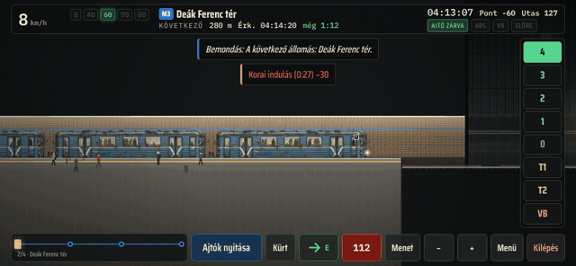
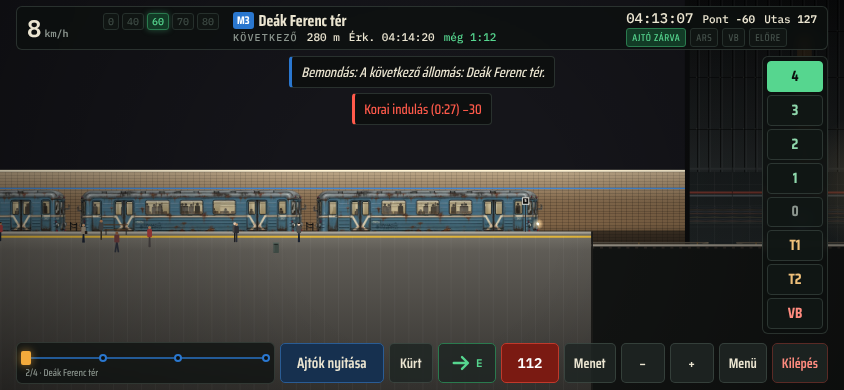
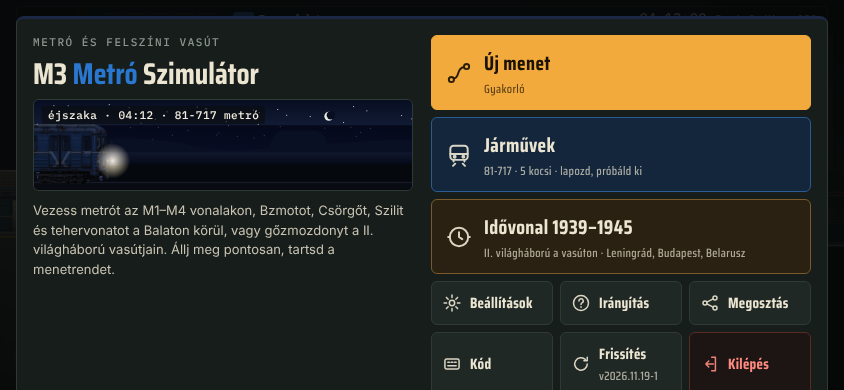

🇬🇧 English · [🇭🇺 Magyar](README.hu.md)

# M3 Metro Simulator

A 2D side-view train driving simulator: take a Budapest 81-717 metro set (and a fleet of Hungarian mainline trains) from station to station, stop on the mark and keep to the timetable. Installable PWA and standalone Android app, works offline.

<p align="center"></p>

<p align="center">
<a href="https://m3metro.vercel.app"><b>▶ Play now</b></a> &nbsp;·&nbsp;
<a href="https://github.com/strattila90-hue/M3Metro/releases/download/apk/m3-metro.apk"><b>📱 Download APK</b></a>
</p>

<p align="center">


</p>

> The game's interface and announcements are in **Hungarian**.

## Features

- **Metro:** lines M1, M2, M3 and M4, a practice route, a full M3 run and a 53-station "network marathon".
- **Mainline railway:** nine surface routes around Lake Balaton, Budapest–Győr and Budapest–Székesfehérvár, plus freight runs (passenger and freight trains, five of the routes are long ones).
- **Vehicles:** 81-717 metro, Bzmot railcar, M41 "Csörgő", V43 electric loco, M44, steam locomotives, with adjustable consist length. Heavier trains accelerate and brake more slowly.
- **Procedurally drawn graphics:** bogies, couplers, lamps, rotating and blurring wheels, no image files for vehicles.
- **Driving model:** lever notches, doors, horn, EVM speed supervision, wheel spin and wheel lock under emergency braking, a timetable to keep and a score for stopping accuracy.
- **Living world:** the scenery follows the real time of day and season (dawn, dusk, night, snow), with signals, level crossings with traffic and incidents (call 112), animals, villages and clouds.
- **Sound:** synthesized diesel and traction sounds, air brake, horns, station chimes and a voice announcer (retro or normal).
- **WWII timeline 1939–1945:** three historical scenarios (Leningrad 1943, Budapest 1944, Belarus 1943) with short summaries and sources.
- **Vehicle viewer**, challenge sharing by code, three difficulty levels.
- **Offline:** service worker in the browser, all files bundled in the APK, automatic update check for the Android app.

## Screenshots

<p align="center">


</p>

## Run locally

No build step, no dependencies:

```bash
git clone https://github.com/strattila90-hue/M3Metro.git
cd M3Metro
python3 -m http.server 8000
# open http://localhost:8000
```

Controls: `↑`/`↓` or `0`–`4` for the lever, `Space` for the doors, `H` for the horn, `R` to reverse direction, `P`/`Esc` for the pause menu (touch buttons on mobile).

## Tech

Vanilla JavaScript and HTML5 canvas in a single `index.html`, Web Audio / speech synthesis for sound, PWA (manifest + service worker). The Android app is a WebView wrapper built with GitHub Actions (`android/`, `.github/workflows/apk.yml`).

## Contributing

Issues and pull requests are welcome, see [CONTRIBUTING.md](CONTRIBUTING.md). The full (Hungarian) documentation of the routes, vehicles and the WWII timeline is in [README.hu.md](README.hu.md).

## License

[MIT](LICENSE) © 2026 strattila90-hue

---

⭐ If you like it, please give it a star — it really helps!
